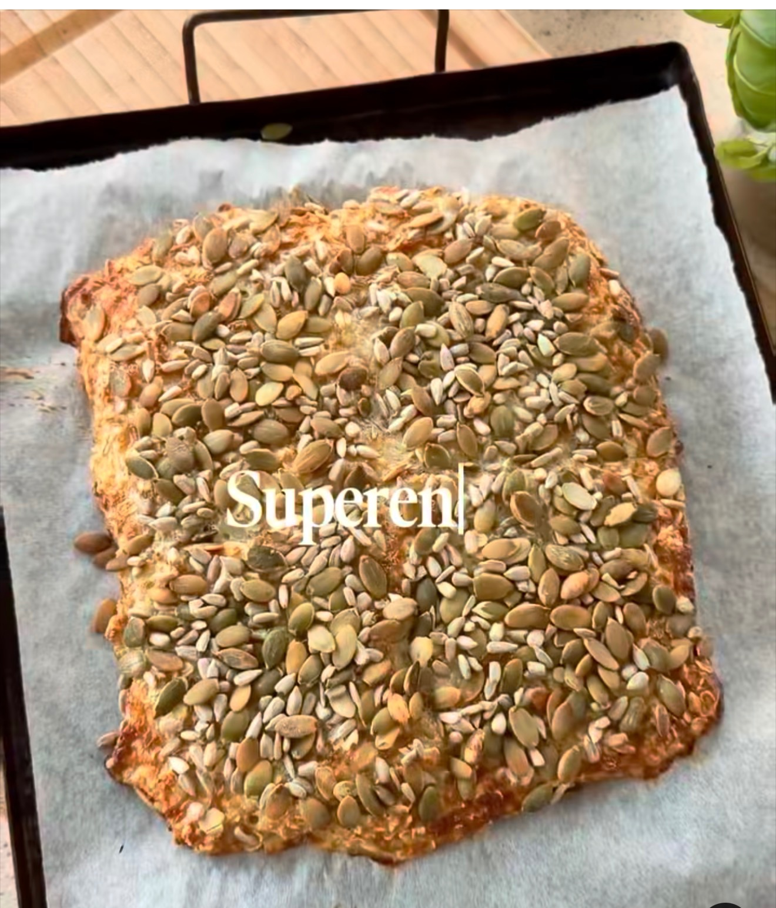

## Ingredienser
.
• 3 dl glutenfria havregryn
• 250 g keso (1 liten burk)
• 2 ägg
• 1 tsk bakpulver
• 0,5 tsk salt
• Topping: Pumpa- & solroskärnor

## Beskrivning
.
GÖR SÅ HÄR:
1. Sätt ugnen på 200°C.
2. Rör ihop alla ingredienser i en bunke. 3. Bred ut smeten på en plåt med bakplåtspapper
(ca 1,5 cm tjock).
4. Strö över kärnorna och tryck till latt. Markera
4-6 rutor med en kniv.
5. Grädda i ca 22 minuter. Bryt isär när det svalnat!

#Bröd